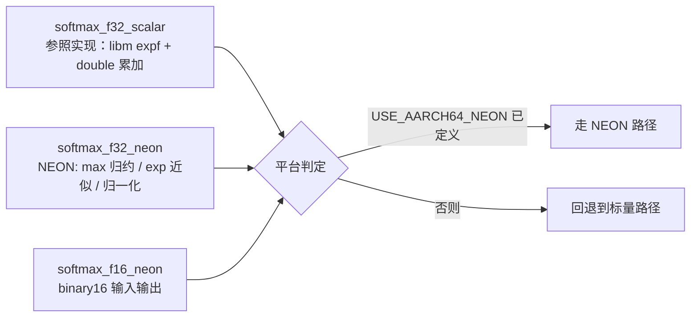

# NEON Softmax Kernel · ARM 向量化的 Softmax 算子

[English](README.en.md) | **简体中文**


> 手写一份能在 aarch64 上跑 NEON 的 softmax：**向量化 max 归约 → 多项式 exp 近似 → 向量化归一化**，
> 同时保留标量实现作为参照与非 ARM 平台的回退路径。
>
> 目标不是调用库，而是搞清楚 `softmax` 这一个算子里到底哪一步在吃时间。

---

## 为什么值得单独写一个 softmax

softmax 出现在每个 attention 层和每个分类头里，它的计算量看起来是 `O(n)` 的加法，
但实际上有三件贵事：

| 步骤 | 朴素做法 | 代价 |
| --- | --- | --- |
| 求最大值（数值稳定） | 一次完整遍历 + 比较 | 访存密集，但可并行归约 |
| `exp(x - max)` | 每元素一次 `expf` | **libm 调用，几十个周期**，是整个算子的瓶颈 |
| 归一化 | 一次除法 + `n` 次乘法 | 除法慢，改成乘倒数 |

所以优化的关键不是"把循环展开"，而是**把 `expf` 换掉**：
用 `exp(x) = 2^k · P(r)` 做范围规约（`k = round(x·log₂e)`，`r = x − k·ln2 ∈ [−0.35, 0.35]`），
余项用一个 5 阶 Taylor 多项式算，最后用 `ldexpf` 把 `2^k` 乘回去。

这套写法的数值误差在 `1e-6` 量级（见测试），但把一次库函数调用换成了
**两次乘法 + 一次整数取整 + 一次位运算式的缩放**，这才是能吃到向量化收益的地方。

---

## 三个实现与分发逻辑



| 文件 | 内容 |
| --- | --- |
| `include/softmax.h` | 公开接口；`SOFTMAX_HALF_T` 在有原生 fp16 时是 `__fp16`，否则是 `uint16_t`（按 IEEE754 binary16 拼装） |
| `src/softmax_scalar_f32.c` | 参照实现：`expf` + **double 累加**（减少误差累积） |
| `src/softmax_neon_f32.c` | NEON：双累加器 8 路展开做 max 归约 → 每 8 个一组算 exp → 向量化乘倒数 |
| `src/softmax_neon_f16.c` | fp16 接口：转 FP32 计算再转回（含完整的 half↔float 位级转换） |
| `src/exp_poly.h` | `exp_approx_float()`：范围规约 + 5 阶多项式 |
| `tests/test_softmax.c` | **6421 条断言**，失败返回非 0 |
| `bench/bench_softmax.c` | 按 `ns/elem` 报耗时，可传 n 与迭代次数 |

---

## 快速开始

```bash
git clone https://github.com/DOUFUQAQ/neon-softmax.git
cd neon-softmax

cmake -S . -B out -DCMAKE_BUILD_TYPE=Release
cmake --build out
ctest --test-dir out --output-on-failure     # 或直接跑 out/test_softmax
./out/bench_softmax 16384 200                # n=16384，200 次迭代
```

在 aarch64 上 CMake 会自动加 `-DUSE_AARCH64_NEON` 并链接 `m`：

```
-- AArch64 detected -> NEON path enabled (USE_AARCH64_NEON)
```

在 x86 上会打印：

```
-- Non-AArch64 platform (AMD64) -> NEON falls back to scalar
```

**回退是可测的，不是口头承诺**：x86 上 `softmax_f32_neon()` 恒等于标量结果，
测试里的对照断言因此依然有效。

---

## 测试覆盖了什么

```
=== 6421 checks, 0 failures ===
```

| 用例 | 为什么要有 |
| --- | --- |
| `null` / `n<=0` | 不许崩，也不许改输出 |
| `n = 1, 7, 8, 9, 1023, 1024, 1025` | **向量循环的 tail 边界**，`i + 8 <= n` 写错这里必炸 |
| 与 double 参考实现的误差 | 标量 < `1e-6`，NEON 路径放宽到 `1e-4`（多项式近似） |
| 平移不变性 `softmax(x+c) == softmax(x)` | 直接验证 max 减法这一层没写错，这是数值稳定性的根 |
| 均匀输入 → 均匀输出 | 早退分支（全相等 / 全 `-inf`） |
| `±100` 极端量级 | 不许出现 `inf` / `nan` |
| 原地运算 `y == x` | 头文件承诺了，就得测 |
| fp16 路径 | 顺序性与总和，容差按 binary16 分辨率放宽 |

参考实现用 `double` 算，避免"拿自己验证自己"。

---

## 实测数据

x86 标量基线（**不是**目标平台，仅供量级参考）：

```
CPU:      AMD Ryzen 5 7500F, gcc 14.2.0 -O2
n=1024     2.06 ns/elem
n=16384    2.19 ns/elem
n=262144   2.25 ns/elem
```

注意：**x86 上 `f32_neon` 与 `f32_scalar` 数字几乎相同**，因为 NEON 分支直接回退到标量。
真正的加速比必须在 aarch64（鲲鹏 / 树莓派 / Apple Silicon）上测，本仓库不提供跨架构的虚假对比。

---

## 已知局限

这几条是这一版真实存在的问题，写在这里而不是藏起来：

1. **NEON 循环里的 exp 仍然是标量调用。** 代码对每 8 个元素先 `vst1q_f32` 落到栈数组，
   逐个调 `exp_approx_float()`（内部还有一次 `ldexpf`），再 `vld1q_f32` 装回去。
   **这等于把向量化的收益又吐了回去**，是当前最大的性能短板——正确做法是把多项式
   和 `2^k` 缩放全部用 NEON 指令实现（`vict`/`vcvtq` 构造指数位、`vmlaq` 跑多项式）。
2. **fp16 路径有精度损失。** `softmax_f16_neon` 先把 `exp` 值量化成 half 存进 output，
   第二轮再读回来乘 `1/sum`。这比"在 FP32 里归一化完再转 half"多丢一次精度，
   与 `softmax.h` 注释里承诺的"FP32 accumulation and normalization"不一致。
3. **`src/exp_poly.c` 是空编译单元**（只有注释），保留它是为了让 CMake 的源文件列表稳定。
4. `exp_approx_float()` 在函数体里写了 `extern float ldexpf(float, int);`，能编过但不是好习惯，
   应该在文件头 `#include <math.h>` 后用标准声明。
5. **只在 2 个累加器上做 8 路展开**，没用 FMA，也没做 4 路以上的多累加器流水。
6. **CI 只跑 x86 标量路径**。NEON 分支需要 aarch64 runner（GitHub 的 `macos-14` 是 arm64，
   可以作为后续的 CI 目标），当前没有覆盖。

## Roadmap

- [ ] 用 NEON 指令实现 exp 多项式 + `2^k` 构造，去掉循环内的标量调用
- [ ] fp16 改为 FP32 归一化后再量化
- [ ] 引入 FMA（`vfmaq_f32`）与多累加器流水
- [ ] 加 `macos-14`（arm64）CI job，让 NEON 分支真的被跑一次
- [ ] 对比 `vdivq` 与倒数近似的精度/速度取舍
- [ ] 补一版 `bfloat16` 接口

## License

[MIT](LICENSE) © 2026 DOUFUQAQ
